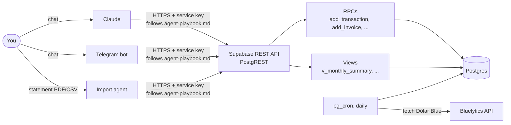

# Personal Accounting System

**Agent-agnostic personal accounting on Supabase.** The whole "app" is a
Postgres schema plus the REST API Supabase generates for it. There is no
frontend, no backend server, no UI — any LLM agent (Claude, a Telegram bot, a
cron script…) *is* the frontend.

You tell an agent *"gasté 15.000 en el súper con la Visa"* or *"¿cuánto pago de
la tarjeta este mes?"*, and it talks to the database over plain HTTP, following
one contract document: [`docs/agent-playbook.md`](docs/agent-playbook.md).

Built for an Argentine freelancer who earns in ARS/USD and thinks in USD, so it
ships with Dólar Blue conversion and an optional monotributo / invoicing
module. The core ledger works anywhere.

---

## Why it's built this way

- **Swap agents freely.** All business rules live in the database (SQL
  functions, constraints, triggers), not in a prompt or an app. Any agent that
  can send an HTTP request gets the same validation and the same answers.
- **One contract, no SDK.** An agent needs two env vars and the playbook.
  That's the full integration.
- **The database refuses bad input.** Unknown category? Missing FX rate?
  Duplicate statement line? The RPC fails with a descriptive error that tells
  the agent how to fix it.
- **Locked down by default.** Everything is restricted to Supabase's
  `service_role`. No anon or public access exists at all.



---

## What it does

### Core ledger
- **Log income and expenses** in ARS or USD. Every ARS amount is converted to
  USD at that day's Dólar Blue rate and stored with the row.
- **Categories and payment methods** are plain table rows — change them live,
  no redeploy.
- **Group payments:** log the full amount you paid, then link each friend's
  repayment to it. Reports show the net cost automatically.
- **Tags** (`viaje-enero`, …) for slicing across categories.
- **Statement import:** an agent parses a bank/card statement, matches lines
  against what you already logged, proposes only the new ones, and dedupes
  re-imports by a stable `external_ref`.

### Credit cards
- **Installments (cuotas):** log a purchase once with its number of cuotas;
  the schedule spreads it over the right statements.
- **Statement projection:** "how much is my next card bill?" — by currency,
  using real cycle dates from statements, or the card's default days as an
  estimate.

### FX rates
- A `pg_cron` job fetches the Dólar Blue rate from
  [Bluelytics](https://api.bluelytics.com.ar) every day.
- A one-off script backfills the full history.

### Fiscal module (Argentina, optional)
- **Invoices** issued in ARCA and **conversions** (selling USD/USDC for ARS,
  depositing cash) are tracked separately from income.
- **Monotributo status:** 12-month invoiced total vs. each bracket's cap,
  headroom, and a `cap_exceeded` flag. Brackets are dated rows, so new ARCA
  scales are just inserts.
- **Deposit tracking:** how much was invoiced, collected, and deposited, and
  what's left to deposit.
- **Weekly invoice batches:** suggests a set of invoices each week so the
  month lands on a target amount, with optional random variation between
  weeks.

Not in Argentina? The core ledger works on its own — just never call the
fiscal RPCs, or remove the fiscal migrations (`005`–`010`, `015`) before the
first apply. See [`docs/configuration.md`](docs/configuration.md).

---

## How an agent uses it

Writes go through RPCs (database functions) that validate everything:

```bash
curl -s -X POST "$SUPABASE_URL/rest/v1/rpc/add_transaction" \
  -H "apikey: $SUPABASE_SERVICE_KEY" -H "Authorization: Bearer $SUPABASE_SERVICE_KEY" \
  -H "Content-Type: application/json" \
  -d '{"p_occurred_on":"2026-07-12","p_type":"outflow","p_description":"supermercado",
       "p_category":"Comida","p_amount":15000,"p_source":"claude"}'
```

Reads are plain GETs on views, with PostgREST filters:

```
GET /rest/v1/v_monthly_summary?month=eq.2026-06-01&type=eq.outflow
GET /rest/v1/v_transactions?tags=cs.{viaje-enero}
```

Anything the views can't answer goes through `run_report`, which accepts a
single read-only `SELECT`.

### The API at a glance

| Kind | Name | What it's for |
|---|---|---|
| RPC | `add_transaction` | Log an income or expense (with optional cuotas) |
| RPC | `set_installments` | Change the cuotas of a logged purchase |
| RPC | `add_card_cycle` | Record a card's closing/due dates from a statement |
| RPC | `add_invoice` | Record an invoice issued in ARCA |
| RPC | `add_conversion` | Record a USD→ARS sale or a cash deposit |
| RPC | `suggest_invoice_batch` | Suggest this week's invoices (read-only) |
| RPC | `run_report` | Run any single read-only `SELECT` |
| View | `v_transactions` | Every transaction, with names and net USD |
| View | `v_monthly_summary` | Totals by month × type × category |
| View | `v_group_expenses` | Group payments: gross, reimbursed, net |
| View | `v_card_statements` | Projected card bill per cycle and currency |
| View | `v_card_schedule` | Every cuota and the statement it falls on |
| View | `v_card_cycles` | Real and estimated card cycles |
| View | `v_deposit_status` | Invoiced / collected / deposited / remaining |
| View | `v_monotributo_status` | Bracket caps, headroom, `cap_exceeded` |
| View | `v_fiscal_balance` | Monthly invoiced vs. declared spending |

Full parameters, workflows, and rules: [`docs/agent-playbook.md`](docs/agent-playbook.md).

---

## Quick start

You need a [Supabase](https://supabase.com) project (free tier works) with the
`pg_cron` and `http` extensions enabled, and Python 3.12+.

```powershell
git clone https://github.com/Tommy-R8/personal-accounting-system.git
cd personal-accounting-system
python -m venv .venv
.venv\Scripts\Activate.ps1        # source .venv/bin/activate on macOS/Linux
pip install -r requirements.txt
copy .env.example .env            # cp on macOS/Linux — then fill in real values
python scripts/apply_migrations.py
python scripts/backfill_rates.py
python -m pytest scripts/test_smoke.py -v
```

Then give your agent `SUPABASE_URL`, `SUPABASE_SERVICE_KEY`, and the playbook.

Step-by-step guide with where to find each key:
[`docs/setup.md`](docs/setup.md).

---

## Documentation

| Doc | Read it when |
|---|---|
| [`docs/setup.md`](docs/setup.md) | Setting up a new Supabase project from zero |
| [`docs/configuration.md`](docs/configuration.md) | Changing categories, cards, FX source, currencies, the fiscal module, or security |
| [`docs/agent-playbook.md`](docs/agent-playbook.md) | Wiring up an agent — this is the interface contract |
| [`docs/superpowers/`](docs/superpowers/) | Design specs and implementation plans for recent features |

---

## Repository layout

```
supabase/migrations/   numbered SQL files — the entire schema, RPCs, views, cron job
scripts/
  apply_migrations.py  applies new migrations in order (tracked in _migrations, safe to re-run)
  backfill_rates.py    one-off Dólar Blue history loader
  test_smoke.py        end-to-end tests against your live project (cleans up after itself)
  lib.py               shared helpers
docs/                  setup, configuration, agent playbook, design docs
```

### Migrations

| # | What it adds |
|---|---|
| `001` | Core schema: transactions, categories, payment methods, security baseline |
| `002` | Daily Dólar Blue fetch via `pg_cron` |
| `003` | `add_transaction` |
| `004` | Reporting views and `run_report` |
| `005`–`007` | Fiscal module: invoices, conversions, monotributo brackets, fiscal views |
| `008` | July 2026 ARCA monotributo scale |
| `009`–`010` | Invoice batch settings and `suggest_invoice_batch` |
| `011`–`014` | Credit cards: cycles, installment plans, schedule/statement views, `set_installments` |
| `015` | Weekly variation for invoice batches |

To change the schema, add a new numbered file and run
`python scripts/apply_migrations.py`. Never edit a migration that's already
applied.

---

## Tests

```powershell
python -m pytest scripts/test_smoke.py -v
```

The smoke tests hit the real RPCs and views on your Supabase project, so they
need a filled-in `.env`. They remove the data they create.

---

## A note on privacy

Some SQL comments reference "spec §…". That points to the original design
document, which is kept out of this repo because it contains the owner's
personal financial details. `.env` and personal data files are gitignored —
the repo holds only schema, scripts, and docs.
